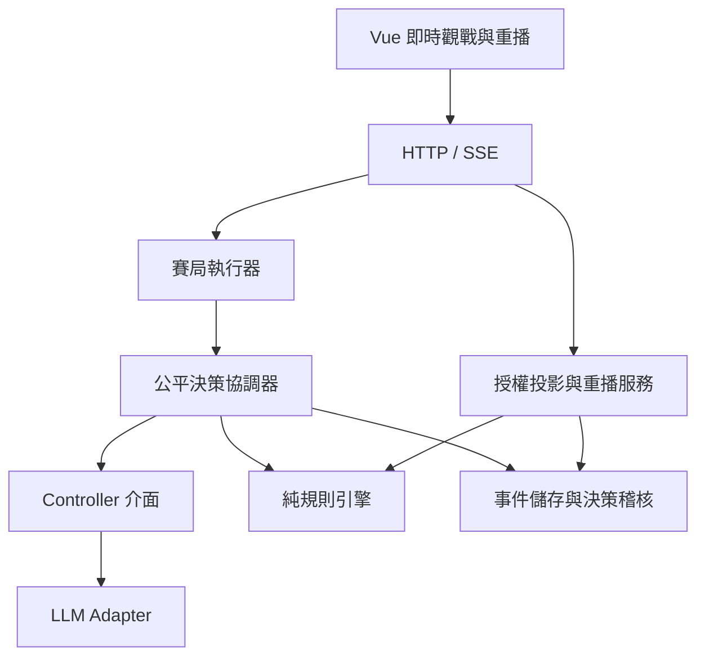

# Minority Pact 實作架構草案

最新覆寫：使用者要求每席不同模型；新增 seatModels 逐席指定模型，llm 保留共用供應商／參數及未提供 seatModels 時的相同模型模式。本文較早的同模型限制被此決定取代。CLI/server 都透過 modelForSeat 取得凍結於本局的模型，投影逐席提供顯示名稱。

狀態：2026-11-08 規劃版，尚未實作。需求來源為 [REQUIREMENT.md](REQUIREMENT.md)。本文件的技術選型與實驗預設均是建議，沒有將未定需求改成已確認。使用者後續回答優先於本草案。

## 1. 建議與範圍

可以開始核心實作，不必等待玩法全部定案。先做規則、事件與權限，再完成一場可保存的真正 LLM 對局，接上即時觀戰與原始資料重播。不要先花成本建立通用多遊戲平台。

建議新建小型 TypeScript 專案，參考 ArenAI 的前後端組織，不整包 Fork。原因與原始碼證據見 [docs/ARENAI_REVIEW.md](docs/ARENAI_REVIEW.md)。第一版採單一後端程序、單一賽局寫入者與 SQLite；瀏覽器只讀授權投影。無須微服務、Redis、訊息佇列或多代理框架。

使用者已確認先在本機執行、瀏覽器觀看，供應商為 OpenRouter；模型從設定檔讀取，不寫死。暫以一場執行中賽局規劃。若未來改為網路服務，再增加身分驗證、操作權限與部署設定，不改規則核心。

設定契約：llm.provider 為 openrouter、llm.model 為必填模型 ID、llm.displayName 為可選顯示名稱、llm.parameters 為五席共用生成／推理設定；API key 讀取 OPENROUTER_API_KEY 環境變數，不寫入設定檔或前端。開局凍結模型與參數，修改設定只影響新局。設定範本的 model 留空並提示填寫，缺少模型時拒絕啟動真實對局，工程測試不需憑證。

觀戰標頭以小字顯示「OpenRouter · 模型名稱」，無 displayName 時顯示 model ID；提示資訊可顯示完整 ID。重播使用該局存檔的模型資訊，不讀目前設定。實際回應的模型識別如可取得也存稽核；不得為失敗的個別席位偷偷切換其他模型，模型不一致應暫停查明。OpenRouter adapter 的具體能力與參數支援於 T5 依官方文件及所選模型驗證。

技術建議：Vue 3 + Vite + TypeScript 前端；Node.js + TypeScript + Express 後端；SQLite 持久化；HTTP 控制請求 + SSE 觀戰事件。共用型別減少 AI 重複猜測介面，SQLite transaction 承擔整批提交，SSE 適合單向觀戰。開工時鎖定相容套件版本，不從參考專案直接複製舊 lockfile。

參考：[Vue TypeScript](https://vuejs.org/guide/typescript/overview.html)、[SQLite transactions](https://www.sqlite.org/transactional.html)、[SSE](https://developer.mozilla.org/en-US/docs/Web/API/Server-sent_events/Using_server-sent_events)。以上選型是本專案的工程判斷。

## 2. 不可破壞的需求摘要

| 約束 | 需求節次 | 實作責任 |
|---|---|---|
| 五名同模型、同資源、無人設 AI；原始目標為獨占冠軍 | 3、6 | controller / prompt |
| 紅藍少數派，B/C 計分，總分後比少數派次數，再平手 | 3、4 | domain |
| 10/12 回合可配置，全員留到終局 | 3 | domain / config |
| 公開交涉與私訊同階段，不設每人發言次數上限 | 3、5 | domain / scheduler |
| 自主等待、時間與事件喚醒；不強迫每 tick 發話 | 6、7 | scheduler |
| 同批合法快照，LLM 等待不消耗遊戲時間 | 7 | coordinator |
| 私訊元資料公開，內容僅雙方；策略僅本人 | 5 | projection |
| 已儲存原文、決策摘要及當時輸入，終局才能全知重播 | 6、9 | storage / replay |
| 真正即時推進，不能整局算完再假裝直播 | 8、18 Q18 | runner / API / UI |
| 保留 human controller；不做真人 UI | 1、17 | controller interface |

不新增契約執行、付費調查、人設、劇情導演、勝率臆測或終局補寫動機。策略摘要是模型主動輸出，不稱為完整內部思考。

## 3. 模組與依賴



```text
src/
  contracts/       對外 DTO、action schema、事件版本；不輸出內部秘密型別
  domain/          state、合法性、phase、score、ranking、純 reducer
  application/     runner、coordinator、clock、scheduler policies、projection、replay
  controllers/     AgentController、LLMController、prompt、context builder
  infrastructure/ sqlite store、provider adapter、設定載入
  server/          路由、SSE、操作授權、錯誤映射
web/src/           Vue 控制台與重播
tests/             domain / fairness / visibility / persistence / integration
configs/           明確標示 experimental 的設定檔
docs/              研究與交接
```

只用一個 npm 專案與清楚目錄即可，暫不拆多個可發布套件。domain 不得 import LLM SDK、資料庫、HTTP 或真實時鐘。UI 不得 import server/internal event store。controller 只拿投影後輸入，不拿完整 GameState 或資料庫連線。

## 4. 核心介面契約

以下名稱作為交接基準；T1 實作時補成可編譯型別與 runtime schema，之後其他任務沿用。

| 介面 | 輸入 → 輸出 | 邊界 |
|---|---|---|
| GameEngine.resolveBatch | State + ValidatedBatch + Rules → DomainEvent[] | 純函式；不呼叫模型 |
| GameEngine.reduce | State + DomainEvent → State | live 與 replay 共用規則語意 |
| AgentController.decide | DecisionInput + AbortSignal → DecisionResult | LLM / 未來 human / 測試 stub 均可替換 |
| Scheduler.nextBoundary | Clock + subscriptions + pending actions → Boundary | 固定窗口及事件驅動共用 coordinator |
| Projection.forAgent | State / events + trusted agent identity → AgentView | 每位 AI 各自合法資訊 |
| Projection.forSpectator | State / events → PublicView | 白名單欄位，不以刪幾個秘密欄位代替 |
| Projection.forReplay | Session + cursor + view → ReplayView | 全知模式只對 completed 賽局開放 |
| EventStore.commitBatch | expectedVersion + batchId + events + checkpoint → CommitResult | 單一 transaction、冪等、版本衝突拒絕 |

DecisionInput 至少含 sessionId、round、phase、logicalTimeMs、batchId、snapshotId、公開規則全文／版本、自身份、合法歷史、自己的備忘錄、喚醒原因。snapshotId 必須對應實際傳入模型的不可變輸入，不只是全域事件序號。

DecisionResult 包含 actions[]、nextWake、strategyNote。action 使用 discriminated union：send_public_message、send_private_message（MVP 單一收件者，可送多筆）、set_ready、vote。空 actions 表示 wait；投票階段只能提交一張合法紅／藍票及備忘錄。nextWake 含可選未來時間與簡單事件種類 OR 訂閱，無條件則睡到必要階段通知。

每筆 action 含 controller 內唯一 actionId 與 scheduledTimeMs。允許有限大小的多 action 回應，沒有每玩家／每回合訊息次數配額；輸出長度、傳輸大小限制屬所有 AI 一致的技術資源，必須寫入實驗設定。超出或截斷視為失敗／重試，不偷偷捨棄後半訊息。

strategyNote 至少包含 goal、plan、whyThisAction、predictedOutcome、observedEventIds；goal 變更必須有 revisionReason。欄位可表達不確定，不能要求編造精妙策略。observedEventIds 必須是該 AI 實際看過的事件；另外保存完整輸入 manifest，避免依賴模型自報作為稽核唯一依據。

## 5. 公平批次與時間（技術方案草案）

時間分為 logicalTimeMs（賽局全程單調遞增）、wall time（供技術稽核）、playback cursor（純觀看）。roundElapsedMs 由回合起始時間計算。即時模式在非運算期間依真實時間推進遊戲時鐘；等待 LLM、故障或人工暫停時停住。批次實際完成後立刻提供觀戰，不把整局預先生成。

每個決策邊界依下列流程處理：

1. 決定到期動作／自主排程喚醒集合。只有開局、階段轉換等共同強制通知，才允許引擎主動喚醒；一般訊息須符合 AI 先前的訂閱。
2. 將較早決策已排定且在本邊界到期的動作一次提交；它們對本邊界的新快照可見。事件引發的訂閱與時間喚醒合併，同一 AI 同一快照只呼叫一次。
3. 凍結遊戲時鐘與狀態版本；從同一全域邊界產生各 AI 合法投影。保存各自實際輸入，發出必要 controller 呼叫。
4. 收齊本批有效結果，保留已成功結果；重試失敗者時使用原快照。其他 AI 不得看到同批已成功結果。不得以 API 回傳先後作排序。
5. 驗證全批，在單一 transaction 保存立即生效事件、備忘錄、未來 action 佇列與下一次喚醒。完成才推送 public projection；不發布半批。
6. 同批立即訊息在提交後才可見，接收者最早在下一決策邊界回應。未來動作到期才出現私訊公開元資料，不能提早洩漏其發送計畫。
7. 評估交涉結束，再恢復時鐘。期限到時先轉入 Commit，交涉動作僅允許 scheduledTimeMs < deadline；取消未執行交涉動作並留下私有稽核原因，不能跨階段送出。

暫定：同批訊息同時生效；commitSeq 只作穩定存檔／畫面次序。顯示同批標記，不能暗示某人已看見同批上一則才回應。批內不同玩家採由 seed + batchId 決定的排列，保留各玩家 actions[] 自身次序；seed 與演算法版本記錄。這是展示排序，不產生同批資訊優勢。

固定窗口：使用 5s 或 15s；AI 請求的時間向上對齊可用邊界，將此規則寫入共同 prompt。不得每窗口無條件呼叫全員。事件驅動：取下一排程時間、事件反應時間或 deadline；訊息反應至少推進可配置的正時間間隔，暫定 1 秒，以免零時間無限互叫。這是公開時間規則、待實測，不能偷偷當成正式玩法。

同時間反覆呼叫／過量待處理事件若觸發技術保護，暫停整局為 paused_error 並記錄，不自動投票、扣分或把它當沉默。wall-clock timeout 不等於遊戲截止時間。

## 6. 規則政策與待決項

| 項目 | 狀態／建議 | 是否阻擋核心實作 |
|---|---|---|
| 部署環境 | 已確認：本機執行、瀏覽器觀戰 | 不阻擋 |
| LLM 供應商／模型 | 已確認 OpenRouter，模型由設定檔指定；具體 ID 開局前填入 | 不阻擋介面；真實驗收需模型與憑證 |
| 回合、分數 | 實驗 10/12；B=5/2，C=8,-2/3,-2；均配置 | 否 |
| 交涉長度 | 暫定實驗 180 秒，非需求定案；開局明示 | 否 |
| 同時生效、下批回應 | 已確認採用為實驗預設 | 可實作，保留可替換 policy |
| 完成交涉 | 已確認實驗預設：可撤回；全員 ready 且該批無新訊息便可提前結束；無待送訊息的額外保護仍屬工程建議 | 可實作，保留可替換 policy |
| ready 公開程度 | 暫不公開各人 ready／思考／喚醒狀態，只顯示整局等待 | 否；可替換 projection |
| 修改投票 | 已確認實驗預設：Commit 才投、一人一張不可修改；五票齊才揭曉 | 可實作，保留可替換 policy |
| 模型失敗 | 同快照最多暫定 2 次重試，仍失敗整局 paused_error | 否；不代選、不因錯誤判輸 |
| 不可能奪冠 | 初版不宣告；提供真實分數與剩餘回合，由 AI 自判並記錄 | 否；嚴格證明器延後 |
| 上下文超出容量 | 不靜默截歷史；暫停並報告，後續再設同等摘要政策 | 否；容量是實測項 |

ready 草案的補充：新訊息使該批不能結束，但不自動清除 ready，也不強制喚醒未訂閱者。下一個邊界無新訊息且仍全 ready 時才能結束。已 ready 者仍可依自己的時間／事件訂閱醒來撤回；時間上限永遠優先。安靜期若需要，另設 policy，不把需求示意的 10 秒寫死。

規則配置開局後不可原地修改；保存 resolved config、schemaVersion、rulesVersion、promptVersion、provider/model、相同推理資源設定、seed。各 AI 收到相同的公開規則（不含其他人的私有排程）。未來選型實驗建立新局。

## 7. 儲存、秘密隔離與故障恢復

SQLite 建議表：sessions（設定、狀態、版本）、events（append-only）、decision_snapshots（每 AI 真實輸入）、decision_attempts（原始回應、驗證錯誤、用量）、batches（pending/committed）、checkpoints（scheduler 狀態）。events 用 UNIQUE(sessionId, commitSeq)，batchId 與 decisionId/actionId 保證重試不重複提交。

DomainEvent 共通欄位：eventId、sessionId、round、phase、logicalTimeMs、batchId、commitSeq、type、actorId、schemaVersion、decisionId（有則填）。內容明確分 publicPayload、participantPayload（收發者 ACL）、ownerPayload（私人策略）；投影產生獨立 DTO，不把完整事件送到瀏覽器。

私訊 publicPayload 僅 sender、recipient、發送時間；策略與未來排程事件整筆隱藏；投票未揭曉時連個別提交進度也暫不公開。必要的整局 waiting 狀態與 heartbeat 是操作狀態，不是虛構遊戲活動。

保存策略的「決策時間」與 action 的「執行時間」兩者；前者不因未來排程改寫。保存失敗嘗試但不把失敗輸出當已執行行為。API key／認證 header 不進存檔或回播；模型可返回的原始內容存受限稽核區，非假稱隱藏推理。

checkpoint 與事件在同一 transaction 提交；發布只在 commit 後。重啟先以事件重建狀態，恢復已保存的 schedule、subscriptions、ready、pending batch；已儲存成功結果不重叫。若 API 已完成但回應尚未落盤，可能必須重叫並記錄重試，不能承諾模型結果逐字重現；已提交遊戲事件不可重複。

status：created → running ↔ paused / paused_error → completed 或 aborted。aborted 不是已完成比賽，不能偽造冠軍；預設不開放公開全知重播。操作方可在本機受限稽核資料檢查故障。

## 8. HTTP、SSE 與重播契約

| 路由 | 用途／限制 |
|---|---|
| POST /api/sessions | 建立配置完整的新局；回傳公開設定 |
| POST /api/sessions/:id/start | 啟動，拒絕重複執行器 |
| POST /api/sessions/:id/pause、resume、abort | 操作方指令，需權限；恢復 pending batch 不改規則 |
| GET /api/sessions/:id | 公開快照含 lastSeq |
| GET /api/sessions/:id/events?after=... | 只回公開事件，供補齊與分頁 |
| GET /api/sessions/:id/stream | SSE 公開串流，id=事件序號，支援 Last-Event-ID |
| GET /api/sessions/:id/replay?view=public或omniscient&through=... | completed 才准 omniscient；按原 cursor 產生狀態 |

身分／角色由伺服器決定，不能信任查詢參數 agentId 或 role=admin。即使本機免帳號，開始／停止等寫入也限制可信 Origin 與操作 token；預設只綁 loopback。對外部署再補正式認證，不擅自公開服務。公開 SSE 永不因終局自動變成秘密串流。

串流以持久化 log 為來源；客戶端按 eventId 去重。初始快照與後續串流以 lastSeq 接續，避免訂閱期間漏事件。授權後快照、分頁、斷線補送都走同一 projection；API error 不附帶原始模型／私訊。

重播完全不呼叫 LLM。分數及 phase 按 cursor 重算，不能直接顯示終局 state；全知投影只解鎖 cursor 已到的原始內容，不偷看未來事件。切回公開視角要清掉秘密 view cache。初版逐事件 fold 即可；效能證據出現後再增加重播快照。

## 9. 驗收底線

1. 五人 32 種投票排列在 B/C 下正確計分；C 每輪總和為零；雙層平手回傳 draw。
2. 固定決策輸出，任意打亂 API 完成順序，domain event、每 AI 輸入、勝負完全一致（技術耗時紀錄可不同）。
3. 同批互相看不到輸出；未訂閱不喚醒；wait 不自動說話；截止與零時間循環有測試。
4. A→B 秘密哨兵文字：C/D/E prompt、public HTTP、SSE、重連、錯誤與快照均不得含此文字；未終局全知端點拒絕。
5. 斷電／重啟模擬不留下半批，不重複票／分數／訊息；失敗者重試仍讀原快照。
6. 終局重播事件逐筆一致，任意 seek 的分數正確；策略時間與當時輸入可追查。
7. 同一 domain 使用測試 controller 跑通，證明未綁死 LLM；測試結果清楚標示為 scripted。
8. 真正五 LLM 完整 10 或 12 回合另存驗收紀錄；未跑之前只能稱工程測試通過。

實驗分階段：先一場真實 smoke，再固定其他變因比較 B/C，接著比較 5s/15s/event-driven 與 10/12。保留多 seed、不挑精彩樣本。seed 只能重現引擎排序；LLM 重新呼叫不保證重現，精確重播依賴已存輸出。

## 手動檔案模式（2026-11-09）

SessionConfig.decisionMode=manual_file 由網頁選擇並保存。ManualFileController 沿用 SYSTEM_PROMPT、授權快照、decisionSchemaFor 與 parseDecision。Coordinator 回傳 waiting_manual，保留部分結果，同批未齊不結算。後端每秒檢查，內容連續兩次相同才讀取；前端輪詢受 token 保護的 manual 進度端點，不傳私有內容。交換檔在 data/manual/對局ID，archive 保存歷史。此模式不建立 OpenRouterController；舊 provider 欄位僅保留相容性。

## 雙人契約付款（2026-11-10）

contractsEnabled 控制新局功能，歷史缺省為關閉。contracts/payment.ts 為共用條件及狀態，domain/payments.ts 封裝只供伺服器使用的結算規則，engine 以契約事件還原狀態、同步批次結算總分。projection 僅向雙方提供相關事件，coordinator 於契約通知後安排下一窗口喚醒。API 與手動提示僅附公開操作規則及動態 schema，不附內部支付門檻；真人介面透過既有授權提交及玩家事件提供同樣行動。結算與契約事件沿用 SQLite append-only 交易與完成後全知重播，不新增資料表。管理者說明見 docs/CONTRACTS_INTERNAL.md。
